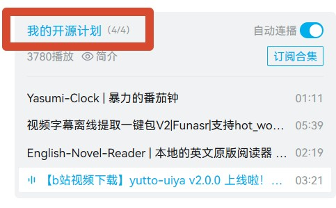

# 📂 合集解析结果不完整

## 🔍 选择解析范围

粘贴合集成员的 BV / AV 播放地址后，应用会检测所属合集。如果发现合集，会显示「选择解析范围」：

- **当前视频（全部分 P）**：仅列出当前投稿的所有分 P。
- **整个合集**：列出该合集的成员及成员内的各个分 P。
- **取消**：不开始解析。

例如，`https://www.bilibili.com/video/BV17zDWYwEj8/?p=2` 属于「测试」合集。验证时，选择当前视频得到 **2 个分 P**；选择整个合集得到 **2 个 BV、3 个条目**。链接中的 `p=2` 不会把「当前视频（全部分 P）」限制成一项。合集内容可能随后续编辑发生变化。

合集入口地址直接解析指定合集。没有所属合集信息的普通投稿直接解析当前 BV；视频标题里写着「合集」不代表它属于 B 站的合集。

## 💡 没有出现范围选择，或结果不完整时

1. **确认应用和内核已更新。** 此交互需要应用中的合集检测功能及 uiya-yutto 0.3.5 或更新内核。便携版需使用内置新版程序和内核的发行包；源码 / uv 环境需同步依赖。
2. **更新后完全退出并重新打开应用。** 已启动的 yutto server 会继续使用原先加载的内核，自定义 Python 环境也需要升级内核。
3. **查看控制台。** 合集检测失败时，应用会提示并继续解析当前视频；成员失效、访问权限和网络错误也可能导致部分条目失败。

## ✅ 使用合集入口排查

点击播放页的合集名称，在 UP 主空间打开合集，再复制合集入口地址解析。

合集入口通常形如 `https://space.bilibili.com/<UP主ID>/lists/<合集ID>?type=season`。这种地址明确指定合集，不依赖当前视频详情中的合集信息。

如果合集入口可以完整解析，而成员播放页没有显示范围选择，请反馈两个地址、应用 / 内核版本和控制台错误。
