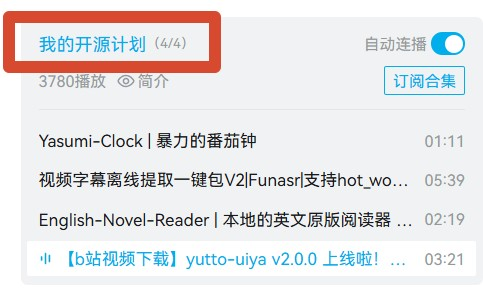

# 📂 合集解析结果不完整

## 🔍 新版支持的解析范围

使用 **uiya-yutto 0.3.4 及以上内核**时，可以直接粘贴合集成员的 BV 播放地址。只要 B 站视频详情返回所属合集信息，点击「解析」就会展开整个合集，并列出成员视频中的各个分 P。

例如，`https://www.bilibili.com/video/BV17zDWYwEj8/?p=2` 属于「测试」合集。验证时合集有两个 BV，其中当前 BV 有两个分 P，解析结果共 **3 个条目、2 个 BV**。链接中的 `p=2` 不会把合集解析限制为当前分 P。合集内容可能随后续编辑发生变化。

没有所属合集信息的多 P 投稿，仍只展开当前 BV 的分 P。解析只获取列表元数据，点击「下载」后才会下载勾选的条目。

## 💡 仍然只得到当前视频或其分 P 时

1. **确认正在使用新版内核。** 旧版内核只会展开当前 BV 的分 P。源码 / uv 环境需拉取包含依赖升级的应用版本后执行 `uv sync`；便携版需使用内置新版内核的应用发行包。仅重启旧版应用不会更新其内置内核。
2. **更新环境后完全退出并重新打开应用。** 已启动的 yutto server 会继续使用原先加载的内核；自定义 Python 环境也需要安装 `uiya-yutto==0.3.4` 或更新版本。
3. **确认视频是否属于合集。** 普通多 P、视频列表和视频合集是不同的组织方式；视频标题里写着「合集」也不代表详情接口会返回所属合集信息。
4. **查看控制台的失败信息。** 视频失效、访问权限和网络错误可能导致部分成员解析失败。

## ✅ 使用合集入口排查

如果播放页仍无法完整展开，可以点击播放页的合集名称，在 UP 主空间打开合集，再复制合集入口地址解析。

合集入口通常形如 `https://space.bilibili.com/<UP主ID>/lists/<合集ID>?type=season`。这种地址明确指定合集，不依赖当前视频详情中的合集信息。

如果合集入口可以完整解析，而成员的播放页不行，请反馈两个地址、内核版本和控制台错误，便于定位接口差异。
